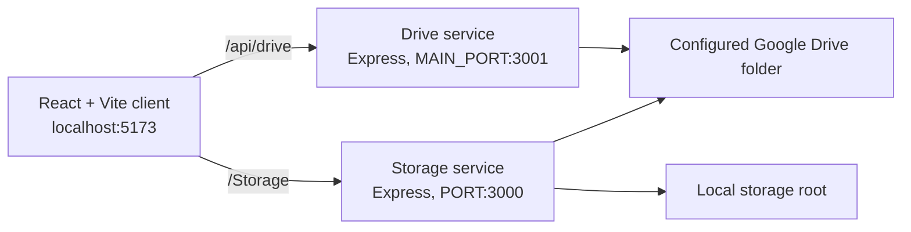

# CloudForge

CloudForge is a local storage console for working with two file sources side by side: a configured Google Drive folder and a directory on the machine running the storage service. Its React interface can browse, download, and delete items from either source, and it also exposes server-side jobs to upload local files/folders to Google Drive or download a Drive backup to a local path.

The project is designed around a Windows local-development setup. The client currently has fixed localhost API URLs and a Windows default storage path.

## Status

This is an in-progress local application. The repository contains the client, two Express entry points, manual request scripts, and Google Drive OAuth setup code, but no deployment configuration, automated test suite, or published release information.

## Implemented functionality

- Browse the contents of a configured Google Drive root folder, including nested folders and breadcrumbs.
- Download regular Drive files in the browser and download Drive folders as ZIP archives.
- Move Drive items to the Google Drive trash; the configured Drive root itself cannot be deleted.
- Browse a local storage directory, download files or ZIP archives of folders, and delete storage items through the browser UI.
- Create a Drive folder, upload one local file, or recursively upload a local folder through storage-service jobs.
- Recursively copy the configured Drive root to a supplied local directory through a server-side backup endpoint.
- Obtain a Google OAuth refresh token interactively with `authorizeGoogleDrive.js`.

### Current limitations

- Google Workspace-native files (for example, Docs, Sheets, and Slides) are not exported by the browser-download routes; those requests return an error. They are also skipped while a Drive folder is zipped.
- The UI uses hard-coded API addresses (`127.0.0.1:3000` and `127.0.0.1:3001`) and a default `C:/Users/Udit/Storage` path; it has no environment-based client configuration.
- Pagination is exposed by the Drive API response but is not used by the React client.
- The upload job responds with `202` before the upload work completes, but performs that work in the same request handler rather than a durable background queue.
- The “Download Drive Backup to Laptop” form has no submit button in the current UI, although its `/Storage/download` endpoint exists.

## Technology stack

| Area | Implementation |
| --- | --- |
| Client | React 19, TypeScript, Vite, CSS |
| Servers | Node.js, Express 5, CORS, Helmet, dotenv |
| Cloud storage | Google Drive API v3 via `googleapis` and OAuth 2.0 refresh tokens |
| Archive generation | `archiver` |
| Local storage | Node.js `fs` / `fs.promises` |
| Tooling | TypeScript, Oxlint |

`bcryptjs`, `jsonwebtoken`, `mongodb`, and `mongoose` are installed in the server package but are not imported by the current application code.

## Architecture



The Drive service scopes browser-facing Drive actions to `GOOGLE_DRIVE_FOLDER_ID`: it walks an item’s parent tree before listing a requested child, downloading, or trashing it. The storage service creates signed item IDs for browser download/delete actions and verifies that decoded paths remain within `STORAGE_ROOT`.

## Repository layout

```text
CloudForge/
├── Client/                         # React/Vite browser interface
│   ├── src/App.tsx                 # UI state and API calls
│   ├── src/App.css
│   └── package.json
├── Server/
│   ├── server.js                   # Google Drive Express service
│   ├── store_server.js             # Local storage Express service
│   ├── authorizeGoogleDrive.js     # Interactive OAuth refresh-token helper
│   ├── config/googleDrive.js       # Google OAuth client configuration
│   ├── routes/driveRoutes.js       # Browser-facing Drive routes
│   ├── Services/driveService.js    # Drive listing, validation, and helpers
│   ├── StorageNode/                # Local storage routes and job handlers
│   ├── TestRoutes/                 # Manual Node request scripts
│   └── package.json
└── DRIVE_FILES_INTERACTION_GUIDE.txt # Historical implementation guide
```

## Prerequisites

- Node.js and npm. The repository does not declare an `engines` version; use a current Node release compatible with the locked dependencies.
- A Google Cloud OAuth client that can use the redirect URI you configure and has Google Drive API access.
- A Google account that can access the Drive folder used as the application root.
- On Windows, a directory to use as local storage. The built-in default is `C:/Users/Udit/Storage`.

## Configuration

Create `Server/.env`. It is ignored by Git; do not commit OAuth secrets or refresh tokens.

```dotenv
# Required by the Drive integration
GOOGLE_CLIENT_ID=your-oauth-client-id
GOOGLE_CLIENT_SECRET=your-oauth-client-secret
GOOGLE_REDIRECT_URI=http://localhost:YOUR_CALLBACK_PORT/callback
GOOGLE_REFRESH_TOKEN=your-refresh-token
GOOGLE_DRIVE_FOLDER_ID=your-drive-folder-id

# Server ports
MAIN_PORT=3001
PORT=3000

# Local-storage service
STORAGE_ROOT=C:/path/to/storage
STORAGE_DOWNLOAD_SECRET=use-a-long-random-secret
```

`MAIN_PORT` is required for `Server/server.js`; it has no fallback. `PORT` defaults to `3000` for `store_server.js`, and `STORAGE_ROOT` defaults to `C:/Users/Udit/Storage`. `STORAGE_DOWNLOAD_SECRET` is required whenever the storage service loads.

### Obtain a Google refresh token

With the first three Google OAuth variables set in `Server/.env`, run the helper from `Server`:

```powershell
node authorizeGoogleDrive.js
```

Open the printed authorization URL, approve access, then paste the redirected URL or authorization code into the prompt. Store the emitted token as `GOOGLE_REFRESH_TOKEN` in `Server/.env`.

The helper requests the Google Drive scope `https://www.googleapis.com/auth/drive`; treat the refresh token as sensitive.

## Install and run locally

Install dependencies for each package:

```powershell
cd Server
npm install

cd ..\Client
npm install
```

Start all three processes in separate terminals from the repository root:

```powershell
# Terminal 1: storage service on http://127.0.0.1:3000
cd Server
node store_server.js
```

```powershell
# Terminal 2: Drive service on http://127.0.0.1:3001 when MAIN_PORT=3001
cd Server
npm run dev
```

```powershell
# Terminal 3: React client (Vite normally serves http://127.0.0.1:5173)
cd Client
npm run dev
```

Open the Vite URL shown in the last terminal. The server CORS allowlist includes Vite’s default localhost addresses and `https://uditdiwani.github.io`; if you serve the client from another origin, update both Express entry points before relying on it.

## Using the application

1. Open the client after both APIs are running. It loads the configured Drive root and local storage listing on startup.
2. Select a folder tile to enter it; use the breadcrumb buttons to return to an earlier location.
3. Select a file tile to download it. Folder download buttons create a ZIP response. Delete buttons trash a Drive item or permanently remove a local storage item.
4. In **Google Drive upload**, choose whether to upload a file, recursively upload a folder, or create a Drive folder. These actions use paths on the machine running `store_server.js`, not a file picker in the visitor’s browser.
5. The **List laptop folder** form calls the storage listing endpoint for the entered path. This is an administrative local-service interface, not a multi-user file browser.

## HTTP endpoints

| Service | Method and path | Purpose |
| --- | --- | --- |
| Drive | `GET /api/drive/items?parentId=` | List the configured root or a child folder. Supports the server-side `pageToken` query parameter. |
| Drive | `GET /api/drive/files/:fileId/download` | Stream a regular Drive file. |
| Drive | `GET /api/drive/folders/:folderId/download` | Stream a ZIP archive of a Drive folder. |
| Drive | `DELETE /api/drive/items/:fileId` | Move an item to Google Drive trash. |
| Storage | `POST /Storage/list` | Recursively list a supplied local path. |
| Storage | `POST /Storage/upload` | Create a Drive folder, upload one file, or recursively upload a local folder. |
| Storage | `POST /Storage/download` | Recursively copy the configured Drive root into a supplied local path. |
| Storage | `GET /Storage/drive-files` | List direct children of the configured Drive root. |
| Storage | `GET /Storage/items/:itemId/download` | Download a signed local-storage item, zipping folders. |
| Storage | `DELETE /Storage/items/:itemId` | Permanently delete a signed local-storage item. |

## Testing and checks

There is no automated test command: `Server`’s `npm test` script intentionally exits with an error, and the files in `Server/TestRoutes` are manual request scripts with machine-specific example paths.

The client provides these checks:

```powershell
cd Client
npm run lint
npm run build
```

During this documentation update, `npm run lint` completed with warnings in `Client/src/App.tsx` about unused state and wrapper object types; it did not report errors. The server JavaScript files also passed `node --check`. The application was not started because a configured Google account, Drive folder, local storage path, and secrets are required.

## Security and privacy notes

- Keep `Server/.env`, OAuth client credentials, and refresh tokens out of source control. The repository ignores `.env` files and the named Google service-account JSON file.
- Browser Drive routes validate that requested Drive items sit below the configured Drive root. Storage browser download/delete requests use HMAC-signed item IDs and reject paths outside `STORAGE_ROOT`.
- The storage listing, upload, and Drive-backup job routes accept local filesystem paths in request bodies. Do not expose the storage service to untrusted users or networks without adding authentication and stricter path authorization.
- Delete behavior differs by source: Drive deletion sets `trashed: true`, while local storage deletion removes files/directories from disk.

## Deployment

No deployment manifest, hosting configuration, or verified public URL is tracked in this repository. A deployment would need to provide the same environment variables, allow the frontend origin in both CORS configurations, supply persistent local storage if the storage service remains enabled, and replace the client’s fixed localhost endpoints.

## Contributing

Keep changes scoped, avoid committing secrets or `node_modules`, and run the relevant client lint/build checks before opening a change. There is no tracked contribution policy or issue workflow.

## License

No repository-level license file is present. The `Server/package.json` metadata declares `ISC`, but the project’s intended repository license should be confirmed before reuse or redistribution.
